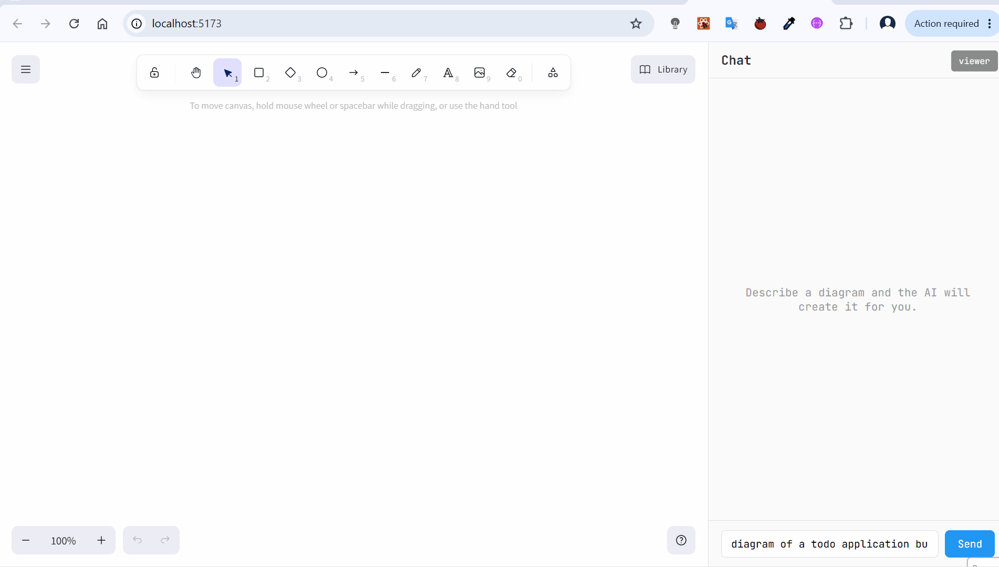
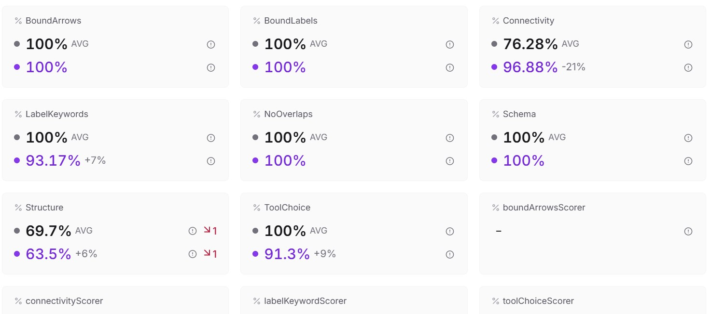

# Excalidraw AI — Diagram Agent

A conversational diagramming agent built on Cloudflare Workers + Excalidraw. You describe a diagram in natural language and the agent draws it, modifies it, and self-corrects layout issues in real time.

Built as a hands-on project while completing the [AI Engineering Fundamentals](https://frontendmasters.com/courses/ai-engineering/) course on Frontend Masters. The course teaches the full AI engineering discipline: building agents, writing evals, measuring improvements, and shipping systems that actually get better over time.

---



<details>
<summary>📊 Eval results (Braintrust)</summary>



</details>

---

## What it does

- **Natural language → diagram**: "draw a sequence diagram for OAuth 2.0" produces a labeled, connected Excalidraw diagram
- **Canvas awareness**: the agent can query the live canvas and modify existing elements by id (`queryCanvas`, `updateElements`, `removeElements`)
- **Self-correcting layout**: every `addElements` call returns overlap pairs; the agent sees them and calls `updateElements` to fix collisions before finishing
- **Web search**: `searchWeb` (Tavily) pulls fresh information before drawing systems the model may not know well
- **RAG**: `searchKnowledge` queries a private Upstash Vector index of reference docs (OAuth flows, Kubernetes networking, PostgreSQL internals, etc.) for precise domain accuracy
- **Streaming chat UI**: tool call status, partial updates, and markdown responses rendered live

## Tech stack

| Layer | Tech |
|---|---|
| Agent runtime | Cloudflare Workers + Agents SDK (Durable Objects) |
| LLM | OpenAI via Vercel AI SDK |
| Frontend | React + Vite + Excalidraw |
| RAG / vector store | Upstash Vector |
| Web search | Tavily |
| Evals | Braintrust |

## Evals

The project includes a full eval suite (`evals/`) that runs against a 30-case golden dataset covering create, modify, and domain-knowledge tasks. Scorers measure:

- **Schema** — do all elements have required fields?
- **Structure** — do element counts match what the prompt asked for?
- **BoundLabels** — does every shape have a `containerId` text label?
- **BoundArrows** — do all arrows bind both endpoints to real ids?
- **Connectivity** — are the shapes in a connected graph when the prompt implies flow?
- **NoOverlaps** — do any element bounding boxes collide?
- **ToolChoice** — did the agent call the right tools in the right order?
- **LabelKeyword** — do label texts match expected keywords?

```bash
npm run eval   # runs all scorers, results appear in Braintrust dashboard
```

## Setup

### 1. Install

```bash
git clone https://github.com/your-username/excalidraw-ai
cd excalidraw-ai
npm install
```

### 2. Environment variables

Create `.dev.vars` at the project root (see `.dev.vars.example`):

```
OPENAI_API_KEY=sk-...
UPSTASH_VECTOR_REST_URL=https://...upstash.io
UPSTASH_VECTOR_REST_TOKEN=...
BRAINTRUST_API_KEY=sk-...
TAVILY_API_KEY=tvly-...
```

| Key | Where to get it |
|---|---|
| `OPENAI_API_KEY` | [platform.openai.com](https://platform.openai.com) → API keys |
| `UPSTASH_VECTOR_REST_URL` + `TOKEN` | [upstash.com](https://upstash.com) → Vector → Create Index (pick any hosted embedding model) |
| `BRAINTRUST_API_KEY` | [braintrust.dev](https://braintrust.dev) → Settings |
| `TAVILY_API_KEY` | [tavily.com](https://tavily.com) → Dashboard |

### 3. Seed the vector index

```bash
npm run embed   # reads data/corpus/*.md and upserts into Upstash
```

### 4. Run

```bash
npm run dev     # starts at http://localhost:5173
npm run eval    # runs the eval suite against Braintrust
```

## Project structure

```
src/
  agent-core.ts          # shared agent logic (system prompt, tools, eval harness)
  agent.ts               # Cloudflare Worker entry point
  App.tsx                # React app, onToolCall handlers
  tools/                 # one file per tool
    add-elements.ts
    query-canvas.ts
    update-elements.ts
    remove-elements.ts
    search-web.ts
    search-knowledge.ts
    element-schema.ts
  context/
    canvas-state.ts      # serialize live canvas to text for the agent
    overlaps.ts          # AABB overlap detection (shared by agent + eval scorer)
    applySkeleton.ts     # Node-side simulator of convertToExcalidrawElements
    cross-call-bindings.ts
  rag/
    vector-store.ts      # Upstash Vector client
    embed.ts             # one-shot corpus ingestion script

evals/
  diagram.eval.ts        # Braintrust eval definition
  buildMessages.ts       # converts golden test cases to ModelMessage[]
  datasets/
    golden_2.json        # 30-case golden dataset
  scorers/               # one file per scorer

data/
  corpus/                # RAG reference documents (Markdown)
```
